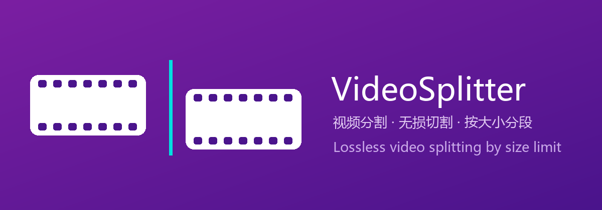

# VideoSplitter 视频分割

[English](README.en.md) | **简体中文**

「视频分割」Android APP：按大小上限把大视频**无损**切成多段（ffmpeg 流复制），支持应用内更新、片段缩略图预览、原视频一键清理。

[**⬇️ 下载最新版本**](https://github.com/Leoxijing/video-splitter/releases/latest) · Android 10+ · 纯免费，仅供个人使用，不做商用

## 功能特性

- **按大小上限自动分段**：默认每段不超过 3.8G，按实际码率换算每段时长
- **无损切割**：ffmpeg `-c copy` 流复制，不重新编码、不损画质
- **超限自动重切**：带 5% 安全余量，切完发现某段仍超限自动缩短重切
- **实时进度**：百分比 + 已切片段数 + 导出进度条
- **片段预览**：结果区缩略图分区展示，点击整行进入播放器（进度条 / ±10 秒快进快退）
- **原视频清理**：二级页缩略图勾选，直接删除（含回收站残留清理）
- **应用内更新**：检查更新 → 下载 → 系统安装会话一键升级
- **完整更新日记**：APP 内置「更新日志」页，离线查看全部版本记录
- **磨砂玻璃浅紫主题**

## 界面预览

<!-- APP 截图放入 docs/screenshots/ 后在此引用，例如：

-->

> 欢迎提交 APP 界面截图（主界面 / 结果区 / 播放页），放入 `docs/screenshots/` 即可展示在此。

## 更新日志

### 🚀 v3.4（最新 · versionCode 26）

- **GitHub 仓库改版**：README 中英双语（参考 Pulse 项目结构），新增项目横幅图
- **APP 内置完整更新日记**：主界面新增「更新日志」入口，离线查看 v1.0 至今全部版本记录

### v3.3（versionCode 25）

- **结果区改版**：原视频与分割后片段**分区展示**（原视频区含缩略图、文件名、大小和删除按钮；片段区独立分组标题）
- **片段行增加视频缩略图**：每个片段显示首帧缩略图（后台加载、中心裁剪），点击整行即可预览
- 片段按序号排序展示

> 完整更新日记（v1.0 至今全部版本，含以上版本）见 [CHANGELOG.md](CHANGELOG.md)；APP 内也可通过「更新日志」查看。

## 文件说明

- `version.json`：最新版本信息（versionCode / versionName / APK 下载地址 / 更新说明）
- Release Assets：每个版本的 APK 与该版本的 version.json
- `CHANGELOG.md`：完整更新日记
- `docs/`：项目横幅图与界面截图

## 下载地址

- 版本信息：`https://github.com/Leoxijing/video-splitter/releases/latest/download/version.json`

## 第三方组件与署名

本 APP 的视频切割能力基于以下开源项目，在此致谢并署名声明：

- **FFmpeg**（通过 [ffmpeg-kit](https://github.com/arthenica/ffmpeg-kit) 调用，`ffmpeg-kit-min` 变体）— 提供无损视频切割（`-c copy` 流复制）核心能力，采用 LGPL-2.1-or-later 许可。项目地址：https://ffmpeg.org/

除上述第三方组件外，本项目的界面、业务逻辑、删除/预览/应用内更新等功能代码均为原创实现。

**许可声明**：本软件纯免费，仅供个人使用，不做任何商用。

**作者：超级小爱 · APP v3.4**
